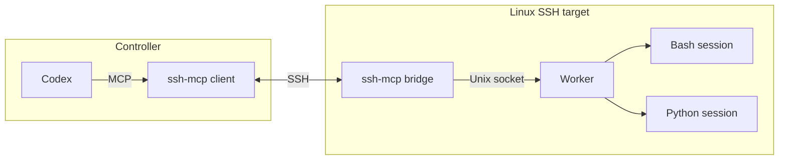
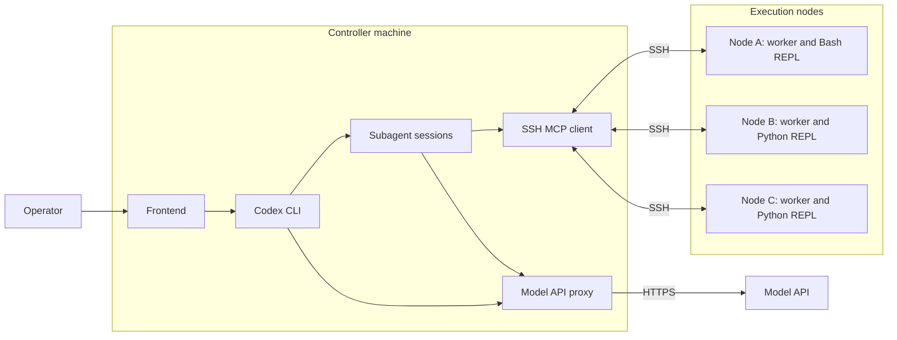

# Lightweight Remote Execution for a Local LLM Agent

COMP7607A Natural Language Processing Project

Yu, Jiawei · 3036809907

## Abstract

This project keeps the Codex CLI on a controller and moves execution to persistent Bash and Python sessions on remote targets. Three pilots measured execution latency, deployment size, and memory. In the three-turn CSV task, a persistent Python session parsed the input once and reduced total execution time from 113.98 ms to 61.02 ms, including session initialization. On Alpine, the worker added 9.17 MiB per target, compared with 478.09 MiB for the official standalone Codex bundle. At the sampled headless checkpoint, the worker-side processes used 22,883 KiB PSS, compared with 157,948 KiB for the Codex CLI and a matched Python workload on the target. Scripted checks covered file I/O, C compilation, CSV analysis, and SSH configuration.

## Project inspiration

On one side I have **N edge devices**, including robots, Android phones, Arduino boards, and Raspberry Pis. On the other I have **M providers and integrations**, including LLM services and tools such as DeepSeek, Claude Code, and ChatGPT, as well as network proxy providers. Configuring every device for every provider can create up to **N × M** combinations to maintain and audit.

LLM gateways and network proxy gateways such as Clash inspired a simpler arrangement: connect each target and each provider to one gateway. The gateway can hold the shared configuration and expose one place to review logs and apply access rules. With one integration per device and per provider, the number of integrations scales as **N + M**. Device-specific settings and access policies can still differ.

The controller is the natural place for model credentials, target profiles, access rules, and a consolidated record of actions and results. Each supported target supplies its workload runtime and a lightweight execution endpoint. The current prototype runs workers on Linux SSH targets. An Arduino-class device could be reached through a connected host, and Android would need an integration suited to its runtime. Centralized audit logging and policy enforcement are design goals for the controller.

## Research question

Can one local Codex instance operate remote environments through thin workers with less per-target deployment overhead? When does a persistent shell or Python session improve remote execution over running each command in a fresh process?

The [proposal](proposal.md) describes the broader design for SSH, Docker, and WSL. This report records public harness measurements and a loopback SSH pilot. The SSH prototype supports persistent Bash and Python sessions, a version handshake with remote system metadata, execution IDs, bounded output reads, reconnecting to live sessions, and SFTP. [SSH MCP implementation](ssh-mcp/README.md)

## Implementation

Codex talks to a local `ssh-mcp` process through MCP. The client opens an SSH channel to a bridge on the target, which relays requests to a worker over a private Unix socket. The worker starts on first use and owns the interpreter processes. When the SSH channel closes, the worker can keep those processes and their state alive.

On opening a session, Codex names the host and chooses Bash or Python. It receives a session ID and a short summary with the worker and protocol versions, OS, architecture, interpreter version, and starting directory. Each submission runs as a complete code block in that interpreter. Bash keeps its working directory and variables. Python keeps its imports and objects, so a later call can use a list or dataset loaded earlier.

Each submission returns an execution ID. The worker captures stdout and stderr separately, and a cursor lets the client read the next chunk. After reconnecting, the client can list the live sessions and continue reading an earlier execution. Closing a session and opening a new one gives Codex a fresh interpreter.

## Public harness resource measurements

Harness Resource Bench ran all three CLI harnesses below in the same Linux environment on November 19, 2026. Installation is the added size of the container image. Memory is proportional set size (PSS), which apportions shared pages across processes. Startup memory comes from the headless startup case, and the 64-turn checkpoint comes from a separate interactive terminal (TUI) case. Session storage includes transcripts, databases, write-ahead logs (WAL), and related files. The rate is the difference between the reported median sizes at turns 4 and 64 divided by 60. [1]

| Harness | Install | Startup PSS | Turn 64 PSS | Session storage, turn 4 → 64 | Net growth |
| --- | ---: | ---: | ---: | ---: | ---: |
| Claude Code 2.1.327 | 356 MiB | 189 MiB | 480 MiB | 0.4 → 23.1 MiB | 386 KiB/turn |
| Codex 0.170.0 | 478 MiB | 121 MiB | 438 MiB | 8.1 → 59.4 MiB | 875 KiB/turn |
| OpenCode 2.3.2 | 241 MiB | 350 MiB | 691 MiB | 8.6 → 17.1 MiB | 145 KiB/turn |

Session-Bench v1 provides a shorter workload. A two-prompt fix averaged 113 KB for Claude Code, 185 KB for Codex, 193 KB for DeepSeek Harness, and 235 KB for OpenCode across three runs per harness. Its accounting can include rows attributable to one session in a shared database. The rates above describe the specific 64-turn workload. [1, 2]

| Harness | Public disk evidence | Public session evidence | Public memory evidence |
| --- | --- | --- | --- |
| Grok Build 1.0.92 | 199 MiB Linux x86-64 executable, from HTTP Content-Length [3] | One roughly 50 MiB `updates.jsonl` report without a turn count or duration [4] | No comparable figure found |
| DeepSeek Harness | 5.94 MiB unpacked for the `@deepseek-ai/dsh` 0.2.2-rc.5 package alone, excluding dependencies and Node.js [5] | 193 KB per two-prompt fix. One reported compressed long session reached 68.6 MB. [2, 6] | `dsh web` 0.2.2-rc.3 user report of 470–700 MB server RSS after restart and 2.0–2.1 GiB RSS plus swap after use [6] |
| HKUDS nanobot | 0.4.2 Linux x86-64 wheel is 60.8 MB compressed and about 161 MB unpacked, excluding Python and dependencies. The unpacked size sums the wheel directory entries. [7] | Session histories and summary archives. No public per-turn rate found. [8] | Maintainer measured about 420 MB RSS for a 0.1.5.post2 gateway. No comparable figure found for 0.4.2. [9] |

### Interpreting memory

The DeepSeek figure covers the Web backend server process. Browser memory would be a separate measurement. The report includes a long-session restoration workload, which can raise server memory. The nanobot figure covers an older gateway process. These RSS observations use different workloads and process boundaries from the CLI benchmark's PSS figures. RSS counts resident pages in full, including shared pages. RSS plus swap also includes memory that is no longer resident. [1, 6, 9]

npm is a distribution method. Node.js, loaded dependencies, the selected frontend or server mode, and retained session state can affect runtime memory. These sources do not isolate the contribution of any one factor. The same CLI benchmark also reports a separate one-turn headless workload, which is a closer reference for scripted execution. [1, 5, 6]

## Planned SSH comparison

Compare the three execution modes on one Linux SSH target. Following Harness Resource Bench, the timed workload uses fixed tool actions and excludes model inference. Following Session-Bench v1, a small independent verifier checks results against the fixture. The headless CLI comparison also motivates measuring startup separately from per-turn time. This pilot requires one host and a small standard-library driver. [1, 2, 10]

| Execution mode | Setup and state |
| --- | --- |
| Exec once | OpenSSH multiplexing reuses an authenticated connection. Each turn executes a fresh remote command. Files can carry explicit state. |
| SSH Bash REPL | Open one `ssh-mcp` Bash session. Working directory, variables, and functions persist. A Python command starts a fresh interpreter each time. |
| SSH Python REPL | Open one `ssh-mcp` Python session. Imports, working directory, and Python objects persist. |

| Workflow | Fixed turns | What it tests |
| --- | --- | --- |
| File check | Return a small fixture's byte length. | Baseline for a task with no prior state. |
| Workspace sequence | Select a fixture subdirectory and define a text filter, then apply it to two files by relative name in separate turns. Use equivalent shell and Python operations. Exec once repeats setup on each later turn. | Reuse of directory and helper definitions. |
| CSV follow-ups | Parse the same fixed 100,000-row integer CSV to report row count, then compute the sum and count above a fixed threshold in separate turns. Use the same Python standard-library calculation in all modes. Both fresh-interpreter modes reopen and parse the file each turn. The Python REPL reuses its parsed list. | Reuse of parsed objects and its memory cost. |

Generate the fixture once from a fixed seed and publish its generation parameters, hash, and expected answers. Keep the target account, runtime versions, working tree, fixtures, and output budget fixed. Start a fresh session or trial workspace for each workflow. Prime the filesystem cache with one untimed pass per mode and leave it enabled. Keep the worker running and the SSH transport warm for timed turns. Record connection and session setup separately, including any version handshake, and include them in a second start-to-finish total. A separate CSV sensitivity check can materialize the parsed list to a temporary file for the fresh-interpreter modes and include its write time, read time, and disk footprint.

Run each workflow five times per mode, interleaving modes in a fixed-seed order for 45 measured trials. Time each turn from submission to complete result with a monotonic client clock. Report median and range by workflow, total time including setup, verified successes out of five, and CSV parse counts. Apply the same per-turn timeout, record wrong answers, timeouts, disconnects, and truncation explicitly, and report latency for completed trials alongside their success count. Measure target-side idle and post-turn memory for the relevant processes, including the worker, interpreter, and retained data. Record transient process memory separately if sampled. Record worker binary size and additional session or cache bytes separately from preinstalled SSH, Bash, Python, and fixture data.

An optional Codex demo can replay the same CSV follow-ups with a pinned model and tool configuration, one trial per mode. Its transcript can show the number of tool calls and whether the agent reuses state. That demo and testing on external SSH hosts are pending.

## Loopback SSH pilot

The [experiment runner](experiments/README.md) documents the loopback, deployment, and memory measurements.

On November 21, 2026, a scripted pilot ran on a single Linux machine with an authenticated loopback SSH fixture, Go 1.27.4, Python 3.14.3, and ssh-mcp 0.2.0. Exec once used one authenticated Go SSH client with a new execution channel per command. Both REPLs used the Go MCP SDK over stdio to call the same ssh-mcp tools a client would use. The fixture kept its worker and SSH transports warm and recreated the REPL sessions once per repetition. The pilot interleaved modes in a fixed order with one untimed warm-up call per mode and used a three-minute overall deadline. Model inference and an external network round trip were absent.

All 90 timed result-producing calls returned the expected output with exit code zero. The filter setup was timed separately from the two filter applications. Direct SSH prepared an executable filter file, Bash retained a shell function and working directory, and Python retained a callable and working directory. The byte-count and filter tasks used each runtime's native operations, so those rows compare the practical interfaces and their chosen commands.

| Workflow | Exec once | Bash REPL | Python REPL |
| --- | ---: | ---: | ---: |
| Byte count | 4.20 ms | 3.12 ms | 1.61 ms |
| Text filter, two applications | 9.22 ms | 5.43 ms | 2.71 ms |
| CSV, three turns | 113.98 ms | 115.22 ms | 30.38 ms |
| CSV, three turns plus a new REPL session when needed | 113.98 ms | 117.22 ms | 61.02 ms |

Values are medians of five per-trial totals. Session opens on warm transports took a median of 2.28 ms for Bash and 30.52 ms for Python. Filter preparation took 7.15 ms for exec once, 5.64 ms for Bash, and 4.83 ms for Python. The initial direct SSH connection took 7.27 ms and initial stdio MCP initialization took 5.32 ms in this run. Initial REPL worker connection and startup were excluded as part of warm-up.

The CSV fixture contained one integer per line from 1 to 100,000, with a trailing newline after each integer. Its SHA-256 was `b2bc7d3f8b652d2ec96865b68ad8f80e22cca174abe1aed7889e242a747d590f`. The expected results were a count of 100,000, a sum of 5,000,050,000, and a count of 50,000 above the threshold of 50,000. All modes used the same Python parser, list representation, and calculations. Exec once and Bash parsed three times, while Python parsed once. Python's warm turn medians were 23.93, 2.15, and 4.22 ms. The three-turn total was 73% shorter than exec once on warm transports and 46% shorter when including the Python session open. Target-only memory and session storage growth were unmeasured in this loopback run. The pilot supports an execution-overhead comparison for these fixtures. External-host performance and Codex task outcomes remain open.

## Per-target deployment footprint

A second pilot used an x86-64 Alpine 3.23 root filesystem with BusyBox, Python 3, and OpenSSH Server. The compilation profile also installed GCC and musl development headers. For each profile, both deployments used the same base and task dependencies. The complete Codex 0.170.0 musl distribution was the published standalone bundle. The worker was ssh-mcp 0.2.0, built with `CGO_ENABLED=0 go build -mod=readonly -trimpath -ldflags='-s -w'`. Sizes below sum regular file contents in the exported base rootfs and the unpacked deployment payload. They exclude container-layer overhead, task outputs, and session logs. [11]

| Footprint | Base only | Target with standalone Codex | Target with ssh-mcp |
| --- | ---: | ---: | ---: |
| Per-target deployment increment | — | 478.09 MiB | 9.17 MiB |
| Alpine + Python + OpenSSH, total | 49.77 MiB | 527.85 MiB | 58.94 MiB |
| Same base plus C toolchain, total | 236.80 MiB | 714.89 MiB | 245.97 MiB |

The standalone bundle adds about **52 times** as many bytes as the worker. The main Codex executable by itself is 284.49 MiB, about **31 times** the worker binary size. This executable-only figure excludes bundled helpers and does not establish a minimal supported installation. With the C toolchain included, the total target footprint is about **2.9 times** as large with the official bundle. With the Python/OpenSSH base, it is about **9 times** as large. The worker configuration keeps the full Codex installation on the client.

| Task | Verification | Passed |
| --- | --- | --- |
| File read/write | Write a two-line text file and verify the readback | Both paths |
| C compilation | Compile a small program and check that it prints 42 | Both paths with the C toolchain |
| CSV analysis | Parse three rows and verify the row count and sum | Both paths |
| Service configuration | Generate a temporary SSH host key, write a config, and verify effective settings using `sshd -T` | Both paths |

The direct path ran the fixed Python task scripts in the Codex-equipped environment, where `codex --version` confirmed startup. The worker path ran the same scripts through a persistent Python session and verified the version handshake, output status, and exit code. Docker carried the bridge over stdin and stdout with networking disabled. The tasks were scripted and there were no model calls. This measures deployment footprint and task execution prerequisites. Agent success rates, remote API connectivity, and SSH service startup remain outside this pilot.

### Headless CLI and worker memory

On the Alpine Python/OpenSSH baseline, five fresh containers per configuration were sampled 250 ms after the checkpoint. The official standalone `codex exec` process waited for a response from a local scripted HTTP endpoint. A separate Python process held a list of 100,000 integers as a workload control. The worker opened a Python REPL through its bridge, loaded the same list, and retained it after the code block completed. Outbound networking was disabled. Measurements cover the selected processes and exclude the measurement driver, mock server, and kernel caches.

| Component PSS | Codex CLI target | SSH worker target |
| --- | ---: | ---: |
| Codex CLI | 147,629 KiB | — |
| SSH MCP bridge | — | 5,031 KiB |
| SSH MCP worker | — | 6,455 KiB |
| Python excluding musl mappings | 10,019 KiB | 11,101 KiB |
| musl mappings | 300 KiB | 296 KiB |
| **Stack total** | **157,948 KiB** | **22,883 KiB** |

Process PSS comes from `/proc/<pid>/smaps_rollup`. The musl entries sum proportional shares for mappings backed by the musl loader in `/proc/<pid>/smaps`; those shares are subtracted from Python before stacking. Values are per-component medians across the five samples, and the stack total sums those medians. The observed process trees contained no Node.js or resident shell, and both targets used Alpine with musl. This is a single memory checkpoint under the documented conditions. The separately launched Python control and the persistent worker interpreter have slightly different resident footprints. The local Codex client is excluded from the worker target by design.

## Conclusion

The pilots support two claims. Keeping a Python interpreter alive improves execution time when consecutive steps reuse parsed data. The Bash REPL retained its shell state, and its CSV timings stayed close to exec once because each step still launched a fresh Python interpreter. Keeping the full CLI on the controller also reduces the software and memory placed on each target. The disk comparison holds the workload dependencies fixed, so the C toolchain's size remains visible in both totals.

The memory comparison is a snapshot of selected target processes with a mock model endpoint and matched Python data. The task checks test execution capability with scripted inputs. Establishing end-to-end task success and performance would require running Codex against a real model on external SSH hosts under equivalent budgets.

## Future work

A controller machine could host the frontend, Codex CLI, an API proxy, and the SSH MCP client. The frontend would submit jobs and display status and results. Codex would plan the work and could delegate independent jobs to subagent sessions managed on the controller. The client would route each job to a target with the required runtime and track its session and execution ID. The proxy would manage model API connectivity and credentials on the controller. Workers would execute code near the files and services they operate on and return results over SSH.

The first cluster prototype could dispatch independent jobs to two or three Linux targets and keep follow-up steps on the node that owns their REPL state. It should measure controller memory and queueing under concurrency, per-node resource use, completion time, and recovery when a worker disconnects or restarts. A reconnect can recover a live execution by ID. A restarted interpreter would require an explicit decision to restore or rerun work. The frontend, proxy integration, and multi-node scheduler are proposed extensions.

## Project contribution and related work

**ssh-mcp** is a small Go tool for forwarding execution over SSH and keeping Bash and Python processes alive. Its MCP interface returns a version handshake, execution IDs, and bounded output. The target worker keeps sessions available for reconnecting clients. The course project includes the implementation and reproducible pilots. [Implementation and setup](ssh-mcp/README.md) · [Experiment runner](experiments/README.md)

The pilots show two practical benefits. The persistent Python session shortened the three-turn CSV task from **113.98 ms to 61.02 ms**, including session setup. The SSH worker added **9.17 MiB** per target, while deploying the full Codex CLI bundle added **478.09 MiB**.

The course proposal took shape before **Codex v0.170.0** was released on November 18, 2026. That release shipped the standalone `codex-exec-server` as **[Experimental]**, providing a native baseline for remote process and file operations. DeepSeek Harness described its SSH helper in **v0.2.1-alpha.2** on October 9, 2026. Its remote programmatic tool calling connects the Code Mode pattern to SSH. The documented setup uses a custom profile and a separately deployed helper. [11–15]

These implementations point to an emerging design direction in agent harnesses: keep the harness on a controller and place a small executor near the workload. The public versions reviewed here expose this pattern through experimental or preview features. Broad adoption has yet to be established from public evidence. [11–15]

## References

1. Leonard Cser. *Harness Resource Bench*, November 19, 2026. [Method and code](https://github.com/leonardcser/harness-resource-bench) · [Run manifest](https://github.com/leonardcser/harness-resource-bench/blob/main/results/2026-11-19/manifest.json) · [Raw summary](https://github.com/leonardcser/harness-resource-bench/blob/main/results/2026-11-19/summary.json)
2. *Session-Bench v1*. [Task and session storage measurements](https://jazzyalex.github.io/agent-sessions/blog/session-bench-v1/)
3. xAI. *Grok Build 1.0.92*. [Package metadata](https://formulae.brew.sh/api/cask/grok-build.json) · [Linux x86-64 release binary](https://x.ai/cli/grok-1.0.92-linux-x86_64)
4. *Grok Build session storage*. [Official session documentation](https://github.com/xai-org/grok-build/blob/main/crates/codegen/xai-grok-pager/docs/user-guide/17-sessions.md) · [Session-size report](https://github.com/farion1231/cc-switch/issues/6660)
5. DeepSeek. [`@deepseek-ai/dsh` 0.2.2-rc.5 registry metadata](https://registry.npmjs.org/@deepseek-ai/dsh/0.2.2-rc.5)
6. DeepSeek Harness. [Web server memory and session-size report](https://github.com/deepseek-ai/deepseek-harness/discussions/13639)
7. HKUDS. [nanobot-ai 0.4.2 release files](https://pypi.org/project/nanobot-ai/0.4.2/#files)
8. HKUDS. [nanobot history and memory documentation](https://github.com/HKUDS/nanobot/blob/main/docs/memory.md)
9. HKUDS. [Maintainer profile of the nanobot 0.1.5.post2 gateway](https://github.com/HKUDS/nanobot/issues/3410)
10. aictrl. [Headless coding-agent CLI benchmark and methodology](https://aictrl.dev/blog/headless-coding-agent-cli-benchmark), October 20, 2026 measurements.
11. OpenAI. [Codex 0.170.0 release and standalone Linux distributions](https://github.com/openai/codex/releases/tag/rust-v0.170.0).
12. OpenAI. [Codex exec-server documentation at 0.170.0](https://github.com/openai/codex/blob/rust-v0.170.0/codex-rs/exec-server/README.md).
13. DeepSeek. [SSH execution subsystem and lifecycle](https://github.com/deepseek-ai/deepseek-harness/blob/2e39e70496aa02986ca6a820c5d497e816b69d7e/docs/subsystems/ssh.md).
14. DeepSeek. [DeepSeek Harness 0.2.1-alpha.2 release](https://github.com/deepseek-ai/deepseek-harness/releases/tag/dsh-v0.2.1-alpha.2).
15. DeepSeek. [SSH provider setup and limitations](https://github.com/deepseek-ai/deepseek-harness/blob/2e39e70496aa02986ca6a820c5d497e816b69d7e/packages/ssh/ssh/README.md).
