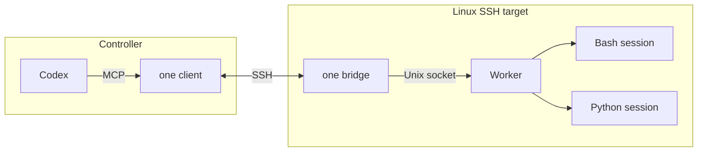
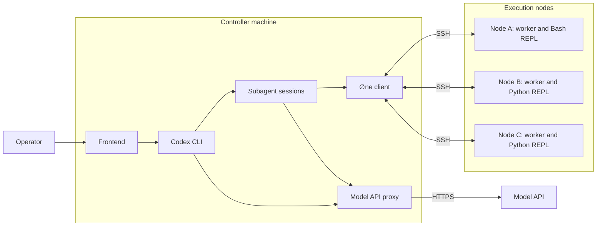

# ∅ne: Lightweight Remote Execution for a Local LLM Agent

COMP7607A Natural Language Processing Project

Yu, Jiawei · 3036809907

## Abstract

This project keeps the Codex CLI on a controller and moves execution to persistent Bash and Python sessions on remote targets. The pilots measured execution and command-launch latency, serialization, deployment size, and memory. In the three-turn CSV task, a persistent Python session parsed the input once and reduced total execution time from 113.98 ms to 61.02 ms, including session initialization. On Alpine, the worker added 9.17 MiB per target, compared with 478.09 MiB for the official standalone Codex bundle. At the sampled headless checkpoint, the worker-side processes used 22,733 KiB PSS, compared with 156,328 KiB for the Codex CLI and a matched Python workload on the target. Scripted checks covered file I/O, C compilation, CSV analysis, and SSH configuration.

## Project inspiration

On one side I have **N edge devices**, including robots, Android phones, Arduino boards, and Raspberry Pis. On the other I have **M providers and integrations**, including LLM services and tools such as DeepSeek, Claude Code, and ChatGPT, as well as network proxy providers. Configuring every device for every provider can create up to **N × M** combinations to maintain and audit.

LLM gateways and network proxy gateways such as Clash inspired a simpler arrangement: connect each target and each provider to one gateway. The gateway can hold the shared configuration and expose one place to review logs and apply access rules. With one integration per device and per provider, the number of integrations scales as **N + M**. Device-specific settings and access policies can still differ.

The controller is the natural place for model credentials, target profiles, access rules, and a consolidated record of actions and results. Each supported target supplies its workload runtime and a lightweight execution endpoint. The current prototype runs workers on Linux SSH targets. An Arduino-class device could be reached through a connected host, and Android would need an integration suited to its runtime. Centralized audit logging and policy enforcement are design goals for the controller.

## Research question

Can one local Codex instance operate remote environments through thin workers with less per-target deployment overhead? When does a persistent shell or Python session improve remote execution over running each command in a fresh process?

The [proposal](proposal.md) describes the broader design for SSH, Docker, and WSL. This report records public harness measurements and scripted pilots for loopback SSH, command dispatch, deployment size, and memory. The SSH prototype supports persistent Bash and Python sessions, a version handshake with remote system metadata, execution IDs, bounded output reads, reconnecting to live sessions, and SFTP. [∅ne implementation](ssh-mcp/README.md)

## Implementation

The loopback SSH and deployment pilots used the pre-rename `ssh-mcp` 0.2.0 executable. The command-serialization pilot used the renamed ∅ne executable and the same worker protocol.

Codex talks to a local `one` process through MCP. The client opens an SSH channel to a bridge on the target, which relays requests to a worker over a private Unix socket. The worker starts on first use and owns the interpreter processes. When the SSH channel closes, the worker can keep those processes and their state alive.

On opening a session, Codex names the host and chooses Bash or Python. It receives a session ID and a short summary with the worker and protocol versions, OS, architecture, interpreter version, and starting directory. Each submission runs as a complete code block in that interpreter. Bash keeps its working directory and variables. Python keeps its imports and objects, so a later call can use a list or dataset loaded earlier.

Each submission returns an execution ID. The worker captures stdout and stderr separately, and a cursor lets the client read the next chunk. After reconnecting, the client can list the live sessions and continue reading an earlier execution. Closing a session and opening a new one gives Codex a fresh interpreter.

## Public harness resource measurements

Harness Resource Bench ran all three CLI harnesses below in the same Linux environment on November 19, 2026. Installation is the added size of the container image. Memory is proportional set size (PSS), which apportions shared pages across processes. Startup memory comes from the headless startup case, and the 64-turn checkpoint comes from a separate interactive terminal (TUI) case. Session storage includes transcripts, databases, write-ahead logs (WAL), and related files. The rate is the difference between the reported median sizes at turns 4 and 64 divided by 60. [1]

| Harness | Install | Startup PSS | Turn 64 PSS | Session storage, turn 4 → 64 | Net growth |
| --- | ---: | ---: | ---: | ---: | ---: |
| Claude Code 2.1.327 | 356 MiB | 189 MiB | 480 MiB | 0.4 → 23.1 MiB | 386 KiB/turn |
| Codex 0.170.0 | 478 MiB | 121 MiB | 438 MiB | 8.1 → 59.4 MiB | 875 KiB/turn |
| OpenCode 2.3.2 | 241 MiB | 350 MiB | 691 MiB | 8.6 → 17.1 MiB | 145 KiB/turn |

Session-Bench v1 provides a shorter workload. A two-prompt fix averaged 113 KB for Claude Code, 185 KB for Codex, 193 KB for DeepSeek Harness, and 235 KB for OpenCode across three runs per harness. Its accounting can include rows attributable to one session in a shared database. The rates above describe the specific 64-turn workload. [1, 2]

| Harness | Public disk evidence | Public session evidence | Public memory evidence |
| --- | --- | --- | --- |
| Grok Build 1.0.92 | 199 MiB Linux x86-64 executable, from HTTP Content-Length [3] | One roughly 50 MiB `updates.jsonl` report without a turn count or duration [4] | No comparable figure found |
| DeepSeek Harness | 5.94 MiB unpacked for the `@deepseek-ai/dsh` 0.2.2-rc.5 package alone, excluding dependencies and Node.js [5] | 193 KB per two-prompt fix. One reported compressed long session reached 68.6 MB. [2, 6] | `dsh web` 0.2.2-rc.3 user report of 470–700 MB server RSS after restart and 2.0–2.1 GiB RSS plus swap after use [6] |
| HKUDS nanobot | 0.4.2 Linux x86-64 wheel is 60.8 MB compressed and about 161 MB unpacked, excluding Python and dependencies. The unpacked size sums the wheel directory entries. [7] | Session histories and summary archives. No public per-turn rate found. [8] | Maintainer measured about 420 MB RSS for a 0.1.5.post2 gateway. No comparable figure found for 0.4.2. [9] |

### Interpreting memory

The DeepSeek figure covers the Web backend server process. Browser memory would be a separate measurement. The report includes a long-session restoration workload, which can raise server memory. The nanobot figure covers an older gateway process. These RSS observations use different workloads and process boundaries from the CLI benchmark's PSS figures. RSS counts resident pages in full, including shared pages. RSS plus swap also includes memory that is no longer resident. [1, 6, 9]

npm is a distribution method. Node.js, loaded dependencies, the selected frontend or server mode, and retained session state can affect runtime memory. These sources do not isolate the contribution of any one factor. The same CLI benchmark also reports a separate one-turn headless workload, which is a closer reference for scripted execution. [1, 5, 6]

## Planned SSH comparison

Compare the three execution modes on one Linux SSH target. Following Harness Resource Bench, the timed workload uses fixed tool actions and excludes model inference. Following Session-Bench v1, a small independent verifier checks results against the fixture. The headless CLI comparison also motivates measuring startup separately from per-turn time. This pilot requires one host and a small standard-library driver. [1, 2, 10]

| Execution mode | Setup and state |
| --- | --- |
| Exec once | OpenSSH multiplexing reuses an authenticated connection. Each turn executes a fresh remote command. Files can carry explicit state. |
| SSH Bash REPL | Open a Bash session with ∅ne. Working directory, variables, and functions persist. A Python command starts a fresh interpreter each time. |
| SSH Python REPL | Open a Python session with ∅ne. Imports, working directory, and Python objects persist. |

| Workflow | Fixed turns | What it tests |
| --- | --- | --- |
| File check | Return a small fixture's byte length. | Baseline for a task with no prior state. |
| Workspace sequence | Select a fixture subdirectory and define a text filter, then apply it to two files by relative name in separate turns. Use equivalent shell and Python operations. Exec once repeats setup on each later turn. | Reuse of directory and helper definitions. |
| CSV follow-ups | Parse the same fixed 100,000-row integer CSV to report row count, then compute the sum and count above a fixed threshold in separate turns. Use the same Python standard-library calculation in all modes. Both fresh-interpreter modes reopen and parse the file each turn. The Python REPL reuses its parsed list. | Reuse of parsed objects and its memory cost. |

Generate the fixture once from a fixed seed and publish its generation parameters, hash, and expected answers. Keep the target account, runtime versions, working tree, fixtures, and output budget fixed. Start a fresh session or trial workspace for each workflow. Prime the filesystem cache with one untimed pass per mode and leave it enabled. Keep the worker running and the SSH transport warm for timed turns. Record connection and session setup separately, including any version handshake, and include them in a second start-to-finish total. A separate CSV sensitivity check can materialize the parsed list to a temporary file for the fresh-interpreter modes and include its write time, read time, and disk footprint.

Run each workflow five times per mode, interleaving modes in a fixed-seed order for 45 measured trials. Time each turn from submission to complete result with a monotonic client clock. Report median and range by workflow, total time including setup, verified successes out of five, and CSV parse counts. Apply the same per-turn timeout, record wrong answers, timeouts, disconnects, and truncation explicitly, and report latency for completed trials alongside their success count. Measure target-side idle and post-turn memory for the relevant processes, including the worker, interpreter, and retained data. Record transient process memory separately if sampled. Record worker binary size and additional session or cache bytes separately from preinstalled SSH, Bash, Python, and fixture data.

An optional Codex demo can replay the same CSV follow-ups with a pinned model and tool configuration, one trial per mode. Its transcript can show the number of tool calls and whether the agent reuses state. That demo and testing on external SSH hosts are pending.

## Loopback SSH pilot

The [experiment runner](experiments/README.md) documents the loopback, deployment, and memory measurements.

On November 21, 2026, a scripted pilot ran on a single Linux machine with an authenticated loopback SSH fixture, Go 1.27.4, Python 3.14.3, and the pre-rename `ssh-mcp` 0.2.0 executable. Exec once used one authenticated Go SSH client with a new execution channel per command. Both REPLs used the Go MCP SDK over stdio to call the same ∅ne tools a client would use. The fixture kept its worker and SSH transports warm and recreated the REPL sessions once per repetition. The pilot interleaved modes in a fixed order with one untimed warm-up call per mode and used a three-minute overall deadline. Model inference and an external network round trip were absent.

All 90 timed result-producing calls returned the expected output with exit code zero. The filter setup was timed separately from the two filter applications. Direct SSH prepared an executable filter file, Bash retained a shell function and working directory, and Python retained a callable and working directory. The byte-count and filter tasks used each runtime's native operations, so those rows compare the practical interfaces and their chosen commands.

| Workflow | Exec once | Bash REPL | Python REPL |
| --- | ---: | ---: | ---: |
| Byte count | 4.20 ms | 3.12 ms | 1.61 ms |
| Text filter, two applications | 9.22 ms | 5.43 ms | 2.71 ms |
| CSV, three turns | 113.98 ms | 115.22 ms | 30.38 ms |
| CSV, three turns plus a new REPL session when needed | 113.98 ms | 117.22 ms | 61.02 ms |

Values are medians of five per-trial totals. Session opens on warm transports took a median of 2.28 ms for Bash and 30.52 ms for Python. Filter preparation took 7.15 ms for exec once, 5.64 ms for Bash, and 4.83 ms for Python. The initial direct SSH connection took 7.27 ms and initial stdio MCP initialization took 5.32 ms in this run. Initial REPL worker connection and startup were excluded as part of warm-up.

The CSV fixture contained one integer per line from 1 to 100,000, with a trailing newline after each integer. Its SHA-256 was `b2bc7d3f8b652d2ec96865b68ad8f80e22cca174abe1aed7889e242a747d590f`. The expected results were a count of 100,000, a sum of 5,000,050,000, and a count of 50,000 above the threshold of 50,000. All modes used the same Python parser, list representation, and calculations. Exec once and Bash parsed three times, while Python parsed once. Python's warm turn medians were 23.93, 2.15, and 4.22 ms. The three-turn total was 73% shorter than exec once on warm transports and 46% shorter when including the Python session open. Target-only memory and session storage growth were unmeasured in this loopback run. The pilot supports an execution-overhead comparison for these fixtures. External-host performance and Codex task outcomes remain open.

## Task quality and context growth

The task pilot crosses two choices independently. Python either starts fresh per action or reuses a ∅ne session. The controller either receives the answer and diagnostic records or receives only the line containing the answer. Each case has three stages. The verifier checks exact typed JSON answers and unchanged input files. Repair tasks also run held-out tests in a fresh process. All runs use disposable containers with the same Python image. [Experiment setup and plotting commands](experiments/README.md#task-quality-and-context-growth)

Fresh and persistent modes ran the same calculations. The fresh reference reloaded inputs for stateful tasks, while the persistent reference loaded once. Both modes could preserve files. Full and bounded output used the same code within each mode. The replay counted code and result tokens with `o200k_base` and summed the input at two scripted model requests per stage. History remained visible throughout. These are simulated requests with real executed tool actions.

| Replay conditions | After stage 1 | After stage 2 | After stage 3 | All checks passed |
| --- | ---: | ---: | ---: | ---: |
| Fresh, full output | 484 | 1,777 | 3,873 | 24/24 |
| Persistent, full output | 484 | 1,755 | 3,783 | 24/24 |
| Fresh, bounded output | 288 | 992 | 2,103 | 24/24 |
| Persistent, bounded output | 288 | 970 | 2,013 | 24/24 |

These means cover six fixtures each for independent file inventory, CSV follow-ups, a normalizer repair, and two-ledger reconciliation. Persistence saved 90 cumulative tokens on average by avoiding repeated setup code. The paired difference was zero for inventory and repair, 140 for analysis, and 220 for reconciliation. Returning the answer alone saved about 1,769 cumulative tokens on average under either execution mode. The full-output reference deliberately includes diagnostic records, so the size of that gain depends on what the task needs the model to inspect.

| Published task subset | Fresh / persistent, full | Fresh / persistent, bounded | Verified runs |
| --- | ---: | ---: | ---: |
| DataBench Forbes, three questions on one table | 19,648 / 19,516 | 2,074 / 1,942 | 4/4 |
| DataBench Titanic, three questions on one table | 27,884 / 27,748 | 1,874 / 1,738 | 4/4 |
| HumanEval/0, typed examples and published tests | 3,658 / 3,658 | 3,658 / 3,658 | 4/4 |
| HumanEval/1, typed examples and published tests | 3,726 / 3,726 | 3,726 / 3,726 | 4/4 |

DataBench uses published questions and answer keys from full tables, with only the required columns retained. The HumanEval canaries reuse a file and return one line per stage, so they have no replay token difference. These subsets test different mechanisms. Their results do not estimate full-benchmark performance. [DataBench paper](https://aclanthology.org/2024.lrec-main.1179/) · [HumanEval paper](https://arxiv.org/abs/2107.03374)

The 112 reference runs establish that the paired scripts and output policies can produce the required artifacts on these tasks. They do not estimate autonomous task success. Time in the replay includes Docker exec on the fresh path and worker RPC on the persistent path. The CSV loopback pilot is the separate measurement of parser reuse on warm SSH transports.

### Model-chosen actions on DataBench

Codex CLI 0.169.1 with `gpt-6.2-sol` at low reasoning produced one Python action for each newly revealed question. The controller included earlier actions and tool results in each prompt, and the same verifier scored both paths. All four DataBench trajectories completed with correct answers at all 12 checkpoints and unchanged inputs. A paired inventory smoke test also passed all six checkpoints. The DataBench figures below come from six provider requests per arm and exclude the smoke test.

| Metric across both DataBench tables | Fresh Python | Persistent ∅ne Python |
| --- | ---: | ---: |
| Correct answers | 6/6 | 6/6 |
| Provider input, including cached tokens | 106,439 | 106,496 |
| Provider cached input | 48,768 | 16,256 |
| Provider output | 1,256 | 1,260 |
| Submitted Python code, offline token count | 1,084 | 1,082 |
| Visible tool results, offline token count | 138 | 138 |

Both arms returned similarly compact results and consumed nearly the same provider input. Cache hits varied by request and were not controlled, so the cached counts do not establish a billing effect. The controlled replay shows how diagnostic output can dominate context growth and where repeated setup code adds tokens. The model pilot provides no evidence of a token reduction when both paths already return compact answers. With two tables and one trajectory per arm and table, success-rate equivalence remains untested.

## Agent tasks over SSH, Docker, and ∅ne

Each trial started two isolated Linux containers from the same image, with separate east and west workspaces. The controller could submit Bash or Python actions on either target. Direct SSH used a warm OpenSSH connection. Direct Docker used the local daemon's `docker exec`. ∅ne used the production MCP server, real SSH, and preopened Bash and Python sessions on each target. The same controller message format, output caps, and action limits applied to all three arms. [Run the comparison](experiments/README.md#two-target-agent-comparison)

The tasks combine error logs from both targets, edit and validate configuration on west and save its validation result on east, or answer three sequential questions over the same 12,000-row dataset. Verification checks each answer, the edited configuration, and unchanged input fixtures. All nine fixed-code reference trials passed. The model run additionally lets Codex choose the language, target, code, batch size, and whether another decision is needed after seeing a tool result.

The agent pilot used Codex CLI 0.169.1 with `gpt-6.2-sol` at low reasoning and one run per task and path. Each path completed all three tasks and passed all ten independent checks. Provider input includes cached tokens. Task time includes model decisions and actions after fixture setup, with setup reported separately.

| Across three tasks | Direct SSH | Direct Docker exec | ∅ne MCP over SSH |
| --- | ---: | ---: | ---: |
| Verified tasks | 3/3 | 3/3 | 3/3 |
| Model decisions / visible actions | 5 / 7 | 5 / 7 | 5 / 7 |
| Transport calls during actions | 7 | 7 | 12 |
| Provider input tokens | 89,301 | 89,316 | 89,416 |
| Provider output tokens | 1,048 | 1,240 | 1,037 |
| Total target action time | 0.611 s | 0.623 s | 0.182 s |
| Total task time | 44.54 s | 49.63 s | 43.37 s |
| Total fixture and session setup time | 4.04 s | 3.51 s | 4.55 s |

∅ne spent about 70% less time in target actions. Its 12 transport calls include MCP output reads managed by the controller. The model saw seven actions in every arm, and its input differed by at most 115 tokens across the three paths. Model decisions dominated wall time. The experiment measures local loopback SSH and Docker on one host. Wide-area networks and agents installed inside the targets are future comparisons.

## Progressively disclosed telemetry benchmark

BFCL v3 seeds a stateful environment, adds one user request at a time, and grades state and response at the end of each turn. ToolSandbox grades changes and intermediate milestones in an interactive trajectory. This benchmark applies those ideas to Bash and Python actions over real SSH, Docker exec, and ∅ne MCP. Exact artifact checks accept different valid implementations. The controller supplies the operator's replies and releases fixtures deterministically, which keeps the information available at each checkpoint identical across paths. [BFCL v3 evaluation](https://gorilla.cs.berkeley.edu/blogs/13_bfcl_v3_multi_turn.html#evaluation) · [ToolSandbox](https://arxiv.org/abs/2408.04682)

The seven checkpoints require an east baseline, a cross-target baseline after the west export arrives, a clarification for an unavailable alert threshold, baseline alerts once the threshold is supplied, a late correction to west, revised combined counts, and an alert-membership diff. The correction moves one service above the threshold and another below it. Verification checks typed artifacts, preserves previous snapshots and inputs, and requires zero actions during the clarification. A failed checkpoint blocks the next release. The matched upfront control asks for the same six artifacts with all inputs and the threshold available from the first prompt. Both versions permit batching and durable caches. [Reproduce the run](experiments/README.md#progressively-disclosed-telemetry-benchmark)

Codex CLI 0.169.1 with `gpt-6.2-sol` at low reasoning completed every checkpoint on every path with no retries. All three asked for clarification without running a command. The same Docker path went from one model decision and three actions upfront to seven decisions and nine actions with staged disclosure. Its longest script fell from 30 lines (1,123 bytes) to 19 lines (756 bytes). Provider input increased from 18,007 to 129,209 tokens as the controller sent the instructions and accumulated history for each decision. These are one trajectory per condition.

| Staged run | Direct SSH | Docker exec | ∅ne MCP over SSH |
| --- | ---: | ---: | ---: |
| Passed checkpoints | 7/7 | 7/7 | 7/7 |
| Model decisions / remote actions | 7 / 9 | 7 / 9 | 7 / 9 |
| Longest code action | 822 B | 756 B | 645 B |
| Provider input tokens, including cached | 129,300 | 129,209 | 129,198 |
| Provider cached input tokens | 34,560 | 16,256 | 18,304 |
| Provider output tokens | 1,430 | 1,377 | 1,367 |
| Target RSS idle / peak / post-task | 26.4 / 37.0 / 27.0 MiB | 9.0 / 19.9 / 9.0 MiB | 83.6 / 94.4 / 86.0 MiB |
| Application code, stdout, and stderr | 3,770 B | 3,629 B | 3,398 B |
| SSH relay traffic, both directions | 8,064 B | — | 11,752 B |
| Docker daemon API traffic, both directions | — | 76,100 B | — |
| Local MCP JSON-RPC traffic, both directions | — | — | 13,685 B |

Provider input differed by 102 tokens across the staged paths. Cache hits varied by request. Target RSS is summed across both containers. ∅ne preopened four interpreter sessions, two per target, which contributes to its larger idle footprint. Transport and Codex CLI memory are recorded separately. The codec timing sums in the local MCP client were 0.25 ms to encode and 0.38 ms to decode across the whole trajectory.

All staged reference runs carried exactly 7,251 application bytes and passed the same 21 checkpoints. Direct SSH carried 11,664 bytes at the relay. ∅ne carried 16,344 bytes at the same boundary and 18,413 bytes at local MCP stdio. Docker moved 79,932 bytes at the daemon socket. Each count describes its own boundary. SSH and MCP counts for ∅ne overlap. The experiment measures command and result I/O, while source file read bytes and Docker daemon codec CPU remain outside this instrumentation.

## Experiment 1: command tokens over SSH and a persistent Python REPL

Six scripted tasks each pose four successive questions on one isolated Linux target. Each pair uses identical input files, Python setup, query expressions, answer format and tokenizer. The direct SSH path keeps its authenticated connection and launches a fresh Python process for each question. It uses whichever of repeating the setup or saving a reusable helper and importing it yields fewer submitted tokens over all four questions. This gives SSH the benefit of hindsight. The ∅ne path submits setup with the first question and retains one interpreter. Process IDs and SSH connection tuples were checked. All 48 answers matched their expected values.

| Four-question task | Direct SSH tokens | Persistent REPL tokens | Tokens saved | Reduction |
| --- | ---: | ---: | ---: | ---: |
| CSV join | 255 | 215 | 40 | 15.7% |
| HTTP log | 109 | 80 | 29 | 26.6% |
| Dependencies | 150 | 109 | 41 | 27.3% |
| Configuration | 101 | 69 | 32 | 31.7% |
| File inventory | 100 | 71 | 29 | 29.0% |
| Independent commands | 35 | 35 | 0 | 0.0% |
| **All six tasks** | **750** | **579** | **171** | **22.8%** |

The five tasks that shared setup used the saved-helper strategy over SSH. They covered joining two CSV tables, filtering HTTP logs, traversing a dependency graph, reading configuration and inspecting files. The four independent commands needed no setup and had identical token counts. The total is weighted by submitted tokens. The fixed commands measure the cost of these implementations; the percentage is not a population estimate or a provider billing measurement. Both paths exclude transport wrappers and verification probes. The earlier four-query pilot used a different import and answer format and is reported separately below.

[Runner and reproduction](experiments/README.md#experiment-1-command-tokens) · [Per-turn code and measurements](experiments/results/experiment-one.json)

## Repeated queries against a remote join

**What persistence bought.** Holding the ∅ne worker, SSH path and query code fixed isolates the lifetime of the joined object. On the 128 MiB fixture, both arms read the same source on query 1. Keeping the object saved one full scan on each of the next seven queries: **896 MiB fewer logical source reads (87.5%)** for **12.79 MiB more target RSS after query 8** relative to resetting the interpreter. At 8 MiB the corresponding differences were 56.01 MiB of reads and 1.05 MiB of RSS. This is the effect measured when the workload actually reuses the object.

A fact table and a dimension table reside on one isolated Linux SSH target. The eight successive questions require cleaning and joining the same rows, then computing totals, filtered group counts, maxima and regional winners. The fixed-code experiment varied the fact table size (8 or 128 MiB) and the lifetime of the joined rows. The disk and memory policies reused the same packed 32-bit representation. The reset control kept the ∅ne transport and replaced its Python interpreter between queries. Every one of the 64 answers matched the independent fixture key. [Method and commands](experiments/README.md#joined-table-follow-ups-over-ssh)

| 128 MiB source, eight queries | Source read (MiB) | Joined cache written / read (MiB) | Target RSS idle / peak / after (MiB) |
| --- | ---: | ---: | ---: |
| SSH, reparse each time | 1,024.01 | 0 / 0 | 13.17 / 36.02 / 13.49 |
| SSH, disk cache | 128.00 | 12.91 / 90.40 | 13.46 / 36.28 / 13.78 |
| ∅ne, retain joined rows | 128.00 | 0 / 0 | 40.41 / 55.69 / 55.69 |
| ∅ne, reset each time | 1,024.01 | 0 / 0 | 40.22 / 55.82 / 42.90 |

The first follow-up already saves one full input scan relative to reparsing. Against the disk cache, keeping the live object avoids 103.31 MiB of intermediate writes and reads over eight queries and uses 41.91 MiB more target RSS after the last answer. Of that difference, 26.95 MiB was present before loading the data. At 8 MiB the same comparison avoids 6.46 MiB of intermediate I/O and retains 30.20 MiB more target RSS. These are logical application bytes for a full-detail sequential cache. An indexed store or a cache of task-specific aggregates can produce a different tradeoff. Each fixed policy ran once per size; memory is sampled process-summed RSS. [Fixed-run curves](experiments/results/reuse-fixed.svg)

### Submitted Python tokens with the SSH connection held open

Four successive queries used the same 8 MiB fixture, Python setup and query expressions. Both direct SSH arms reused the authenticated OpenSSH connection and launched a fresh Python process for each request. The saved-helper arm submitted the module contents on its first call and imported the module on every call. The persistent arm defined the same objects once. A reset control replaced its interpreter before each follow-up. The probe verified the SSH connection tuple on each direct path and checked the interpreter PID pattern in every arm. All 16 answers passed.

| Cumulative Python tokens | Query 1 | Query 2 | Query 3 | Query 4 |
| --- | ---: | ---: | ---: | ---: |
| SSH, inline setup | 147 | 296 | 465 | 618 |
| SSH, save and import helper | 180 | 209 | 258 | 291 |
| Persistent Python REPL | 147 | 167 | 207 | 231 |
| REPL reset between queries | 147 | 296 | 465 | 618 |

Relative to SSH with the saved helper, the persistent arm saved 60 submitted tokens across four queries. Of these, 33 came from the first-call file-writing and import code, and nine from each subsequent import. Relative to inline SSH it saved 387 tokens by omitting setup on three follow-ups. Resetting the REPL reproduced the inline SSH count on every query. These are deterministic o200k_base counts of submitted Python for the stated implementations. SSH wrappers, measurement probes and provider prompts are outside the count. A preinstalled helper or shorter imports would change the comparison. [Cumulative curve](experiments/results/reuse-command-tokens.svg)

### Reuse strategies selected by the model

With the 128 MiB source, three pairs of eight-turn runs used `gpt-6.2-sol` at low reasoning. The authenticated Codex CLI proposed Bash or Python actions over the same controller interface. Both paths could batch operations, save a reusable program or cache results on the target. The prompt described the two source tables on each turn and disclosed the current question only. All 48 checkpoint answers passed and each trajectory preserved the input hashes. [Model token curves](experiments/results/reuse-live.svg)

| Per eight-turn trajectory | Direct SSH | ∅ne over SSH |
| --- | ---: | ---: |
| Submitted command tokens, pairs 1 / 2 / 3 | 1,763 / 1,717 / 1,803 | 1,239 / 1,859 / 1,666 |
| Mean submitted command tokens | 1,761 | 1,588 |
| Mean provider output tokens | 2,306 | 2,083 |
| Mean provider input tokens, including cached | 152,380 | 152,180 |
| Mean cached input tokens | 49,451 | 71,381 |

Mean submitted command tokens fell 9.8% and provider output fell 9.7%. Two pairs favored ∅ne for command tokens; in pair 2 its commands used 142 more. The common controller instructions and accumulated history dominated provider input, which differed by 0.13%. Cache hits varied between model calls. With three paired trajectories these are observed differences for this workload.

An instrumented replay of the recorded model actions reproduced all 48 answers and exit outcomes. Direct SSH opened the fact table on 24 of 24 actions and the dimension table on 24. ∅ne opened them on 23 and 18 actions respectively. One ∅ne trajectory reused a previous aggregate to answer the last question; the other two reopened both source files on every turn. After the last answer target RSS ranged from 13.64 to 13.80 MiB on SSH and 44.17 to 44.72 MiB on ∅ne. These live-interface replays opened Bash and Python for ∅ne, while the fixed replay opened Python only. The file-open counts measure access frequency. Only the fixed replay instruments logical data bytes. [Model-action replay curves](experiments/results/reuse-trace.svg)

Pairing token differences with the file-open trace clarifies the model result. In pair 1, ∅ne used 524 fewer command tokens and opened the fact table on seven actions versus eight. In pairs 2 and 3 both paths opened both inputs on every action. ∅ne used 142 more command tokens in pair 2 and 137 fewer in pair 3. The aggregate command-token saving is therefore descriptive; the data do not identify avoided fact-table scans as its cause. Persistent state eliminated repeated source reads in the controlled implementation, while this model usually chose to reopen the source.

## Model-generated PowerShell wrappers

Five Bash fixtures cover an ordinary command, multiline control flow, quotes, dollar expressions and a 1,177-byte script containing nested JSON. The task was to transport the exact source, including its final newline. Every live submission passed on its first attempt on all three paths: the decoded source, exit status, stdout and target artifact matched. Each cell used one independent low-reasoning `gpt-6.2-sol` request. The controller mapped the target alias to the isolated fixture. [Method and commands](experiments/README.md#powershell-wrapper-supplement)

| Across five tasks | ∅ne MCP over SSH | PowerShell → SSH | PowerShell → Docker |
| --- | ---: | ---: | ---: |
| Submitted command + stdin tokens | 449 | 484 | 489 |
| Provider output tokens | 725 | 776 | 826 |
| Provider input tokens, including cached | 88,318 | 88,497 | 88,509 |
| Verified on first attempt | 5/5 | 5/5 | 5/5 |

The model used stdin on all ten PowerShell submissions. In this interface that cost seven extra submitted tokens per SSH call and eight per Docker call, independent of script length. With a fixed inline command, the quote-heavy fixture instead took 67 tokens through PowerShell and SSH, 41 through PowerShell and Docker, and 28 through ∅ne. These figures isolate command text. At the shared SSH relay, the 1,177-byte fixture moved 2,792 bytes over direct SSH and 3,832 bytes over ∅ne during the live calls. The token saving and the transport framing cost can coexist. [Model-chosen command curves](experiments/results/wrapper-model.svg) · [Fixed inline curves](experiments/results/wrapper-replay.svg)

A second set of 15 model calls added the option to write and run `job.sh` on the target. All 15 passed on their first attempt. The model again chose direct code on ∅ne and stdin on both PowerShell paths. Total submitted tokens were unchanged at 449, 484 and 489 respectively. Provider output in this free-choice condition was 765, 776 and 804. The separate file-only reference verified the exact saved script on all 15 tasks. When a saved script was required, the fixed commands used 544, 509 and 539 tokens respectively. The ∅ne file reference included a Bash heredoc to write the file; direct SSH streamed its contents into the remote command. [Free-choice curves](experiments/results/wrapper-free-model.svg) · [File-only controls](experiments/results/wrapper-file-replay.json)

The inline replays measured the actual Docker ExecCreate HTTP body on the local daemon socket. For the 1,177-byte script it was **1,609 bytes**, including **1,453 bytes** for the encoded `Cmd` array. Sending that script over stdin reduced the body to **169 bytes**, including a **13-byte** `Cmd` array; all 1,177 script bytes traveled separately on stdin. The 28-byte ordinary script also produced a 169-byte body over stdin. This isolates the three operations in the inline example: PowerShell parses its literals, Docker encodes its argument vector as JSON, and Bash parses the decoded script. Using stdin removes the script contents from the argument vector. [Inline replay data](experiments/results/wrapper-replay.json) · [Matched stdin captures](experiments/results/wrapper-replay-stdin.json)

## Command serialization and launch on Linux

On November 24, 2026, the same Bash script ran through PowerShell 7.6.6 and Docker 29.9.2, and through the current ∅ne 0.2.0 worker with a persistent Bash session. Both targets used Bash 5.3.9 from the same pinned Alpine-based image. The test ran on one Fedora 44 x86-64 host with a Ryzen 7 5800H and Go 1.27.4. The worker used its real request protocol on a private Unix socket. This isolates the worker path from SSH, MCP, and model inference. [Reproduce the experiment](experiments/README.md#serialization-and-command-launch)

The first Bash statement records when the script begins. Launch time runs from the client's dispatch to that timestamp. Completion includes receiving the final result. Each row contains 30 latency trials and five separate memory trials. The peak is the largest sampled combined RSS of the launcher tree and target processes across those five trials. The sampler runs every 2 ms. Shared Docker services and the benchmark driver are outside the memory boundary.

| Script bytes | Execution path | Launch median | Launch p95 | Completion median | Peak sampled RSS |
| ---: | --- | ---: | ---: | ---: | ---: |
| 49 | Fresh PowerShell → Docker exec → Bash | 171.77 ms | 177.22 ms | 218.54 ms | 131.8 MiB |
| 49 | Warm PowerShell → Docker exec → Bash | 50.12 ms | 51.33 ms | 53.30 ms | 151.9 MiB |
| 49 | ∅ne worker → warm Bash | 1.13 ms | 1.25 ms | 1.43 ms | 12.4 MiB |
| 1,073 | Fresh PowerShell → Docker exec → Bash | 171.30 ms | 179.46 ms | 217.80 ms | 131.8 MiB |
| 1,073 | Warm PowerShell → Docker exec → Bash | 50.00 ms | 52.65 ms | 53.20 ms | 152.4 MiB |
| 1,073 | ∅ne worker → warm Bash | 2.28 ms | 2.47 ms | 2.80 ms | 13.0 MiB |
| 16,433 | Fresh PowerShell → Docker exec → Bash | 176.33 ms | 183.88 ms | 224.01 ms | 133.0 MiB |
| 16,433 | Warm PowerShell → Docker exec → Bash | 50.87 ms | 52.89 ms | 54.57 ms | 154.4 MiB |
| 16,433 | ∅ne worker → warm Bash | 18.66 ms | 19.95 ms | 19.30 ms | 16.1 MiB |

The codec microbenchmarks separately time PowerShell quote construction and parsing, the Docker Exec Create JSON body, and ∅ne's actual JSON request frame. Values are microseconds per operation. Bash syntax checking is amortized over 512 commands from a local file. The PowerShell parsing measurement excludes native process creation. The JSON measurements use in-memory I/O and exclude the Docker daemon's HTTP and container runtime work. [Docker Exec Create request schema](https://github.com/moby/moby/blob/docker-v29.9.2/api/types/container/exec_create_request.go)

| Script bytes | PowerShell quote / parse (µs) | Docker JSON encode / decode (µs) | ∅ne frame encode / decode (µs) | Bash parse (µs) |
| ---: | ---: | ---: | ---: | ---: |
| 49 | 0.17 / 18.43 | 0.83 / 2.59 | 0.72 / 1.79 | 3.91 |
| 1,073 | 0.64 / 27.55 | 2.66 / 6.14 | 3.15 / 7.79 | 31.25 |
| 16,433 | 6.19 / 211.67 | 27.82 / 53.02 | 30.39 / 85.77 | 361.33 |

For the 1,073-byte script, Docker's JSON body was 1,244 bytes and ∅ne's request frame was 1,185 bytes. Both paths encode a request and Bash still parses the script on each invocation. The codec measurements are much smaller than the observed launch delays. Process startup, communication, and target dispatch are also part of launch. ∅ne's median launch rose from 1.13 ms to 18.66 ms across the tested sizes. This run did not attribute that growth to individual stages of the live worker path.

## Per-target deployment footprint

The deployment pilot used an x86-64 Alpine 3.23 root filesystem with BusyBox, Python 3, and OpenSSH Server. The compilation profile also installed GCC and musl development headers. For each profile, both deployments used the same base and task dependencies. The complete Codex 0.170.0 musl distribution was the published standalone bundle. The worker was the pre-rename `ssh-mcp` 0.2.0 executable, built with `CGO_ENABLED=0 go build -mod=readonly -trimpath -ldflags='-s -w'`. Sizes below sum regular file contents in the exported base rootfs and the unpacked deployment payload. They exclude container-layer overhead, task outputs, and session logs. [11]

| Footprint | Base only | Target with standalone Codex | Target with ∅ne |
| --- | ---: | ---: | ---: |
| Per-target deployment increment | — | 478.09 MiB | 9.17 MiB |
| Alpine + Python + OpenSSH, total | 49.77 MiB | 527.85 MiB | 58.94 MiB |
| Same base plus C toolchain, total | 236.80 MiB | 714.89 MiB | 245.97 MiB |

The standalone bundle adds about **52 times** as many bytes as the worker. The main Codex executable by itself is 284.49 MiB, about **31 times** the worker binary size. This executable-only figure excludes bundled helpers and does not establish a minimal supported installation. With the C toolchain included, the total target footprint is about **2.9 times** as large with the official bundle. With the Python/OpenSSH base, it is about **9 times** as large. The worker configuration keeps the full Codex installation on the client.

| Task | Verification | Passed |
| --- | --- | --- |
| File read/write | Write a two-line text file and verify the readback | Both paths |
| C compilation | Compile a small program and check that it prints 42 | Both paths with the C toolchain |
| CSV analysis | Parse three rows and verify the row count and sum | Both paths |
| Service configuration | Generate a temporary SSH host key, write a config, and verify effective settings using `sshd -T` | Both paths |

The direct path ran the fixed Python task scripts in the Codex-equipped environment, where `codex --version` confirmed startup. The worker path ran the same scripts through a persistent Python session and verified the version handshake, output status, and exit code. Docker carried the bridge over stdin and stdout with networking disabled. The tasks were scripted and there were no model calls. This measures deployment footprint and task execution prerequisites. Agent success rates, remote API connectivity, and SSH service startup remain outside this pilot.

### Executables and shared libraries

The official x86-64 musl bundle contains several executables. Inspection with `readelf` found no ELF interpreter or `DT_NEEDED` shared-library entries in the main Codex CLI, exec server, Code Mode host, bundled ripgrep, or bubblewrap. These are statically linked builds. The main binary alone returned its version on the pinned Alpine base image, and the full bundle ran the headless memory checkpoint on the Alpine Python/OpenSSH profile. [11]

| Component in the Codex archive | Unpacked size | Runtime linkage |
| --- | ---: | --- |
| Main `codex` executable | 284.49 MiB | Static PIE |
| `codex-exec-server` | 71.06 MiB | Static PIE |
| `codex-code-mode-host` | 66.87 MiB | Static PIE |
| Voice resources and helper | 50.01 MiB | Voice executable uses the glibc loader |
| Bundled ripgrep and bubblewrap | 5.64 MiB | Static PIE |

The voice directory includes **11.72 MiB** of shared libraries within its 50.01 MiB total. The voice executable references libraries such as GLib, GStreamer, Opus, and glibc. None of the voice processes appeared in the headless checkpoint. Both measured profiles already supplied the workload's shared native dependencies: Alpine's musl loader, `libpython3.12.so.1.0` for Python, and `libcrypto.so.3` for OpenSSH. The stripped Go worker itself was statically linked. The C build profile supplies the same compiler and musl development headers to both setups. Shared-library files count toward the installed footprint where they are shipped. They contribute to process PSS when their pages are resident.

### Headless CLI and worker memory

On the Alpine Python/OpenSSH baseline, five fresh containers per configuration were sampled 250 ms after the checkpoint. The official standalone `codex exec` process waited for a response from a local scripted HTTP endpoint. A separate Python process held a list of 100,000 integers as a workload control. The worker opened a Python REPL through its bridge, loaded the same list, and retained it after the code block completed. Outbound networking was disabled. Measurements cover the selected processes and exclude the measurement driver, mock server, and kernel caches.

| Component PSS | Codex CLI target | SSH worker target |
| --- | ---: | ---: |
| Codex CLI, file-backed pages | 116,825 KiB | — |
| Codex CLI, anonymous pages | 29,164 KiB | — |
| ∅ne bridge | — | 4,927 KiB |
| ∅ne worker | — | 6,421 KiB |
| Python excluding musl mappings | 10,039 KiB | 11,085 KiB |
| musl mappings | 300 KiB | 300 KiB |
| **Stack total** | **156,328 KiB** | **22,733 KiB** |

The file-backed pages in the Codex process account for **116,825 KiB of the 133,595 KiB difference**, or about **87%**. The standalone executable is the dominant named mapping. Its mappings account for **120,656 KiB PSS**, including some anonymous pages, so that figure overlaps the two Codex rows. Anonymous PSS can include heap, stack, and private copies of mapped pages. This measurement does not identify which Rust modules allocated it. The Python and musl figures are similar across targets.

Process PSS comes from `/proc/<pid>/smaps_rollup`. The musl entries sum proportional shares for mappings backed by the musl loader in `/proc/<pid>/smaps`; those shares are subtracted from Python before stacking. Values are per-component medians across the five samples, and the stack total sums those medians. The observed process trees contained no Node.js or resident shell, and both targets used Alpine with musl. This is a single memory checkpoint under the documented conditions. The separately launched Python control and the persistent worker interpreter have slightly different resident footprints. The local Codex client is excluded from the worker target by design.

## Conclusion

Keeping a Python interpreter alive improves execution time when consecutive steps reuse parsed data. The Bash REPL retained its shell state, and its CSV timings stayed close to exec once because each step still launched a fresh Python interpreter. Returning compact tool results reduced context growth in diagnostic-heavy replay. The small model pilot used compact results in both arms and found nearly identical provider token use. Keeping the full CLI on the controller also reduces the software and memory placed on each target.

The memory comparison is a snapshot of selected target processes with a mock model endpoint and matched Python data. The two-target agent pilot found faster target actions with ∅ne and nearly identical model input. A larger study on external SSH hosts would be needed to estimate effects on task success and end-to-end performance.

## Future work

A controller machine could host the frontend, Codex CLI, an API proxy, and the ∅ne client. The frontend would submit jobs and display status and results. Codex would plan the work and could delegate independent jobs to subagent sessions managed on the controller. The client would route each job to a target with the required runtime and track its session and execution ID. The proxy would manage model API connectivity and credentials on the controller. Workers would execute code near the files and services they operate on and return results over SSH.

The first cluster prototype could dispatch independent jobs to two or three Linux targets and keep follow-up steps on the node that owns their REPL state. It should measure controller memory and queueing under concurrency, per-node resource use, completion time, and recovery when a worker disconnects or restarts. A reconnect can recover a live execution by ID. A restarted interpreter would require an explicit decision to restore or rerun work. The frontend, proxy integration, and multi-node scheduler are proposed extensions.

## Project contribution and related work

**∅ne** is a small Go tool for forwarding execution over SSH and keeping Bash and Python processes alive. Its MCP interface returns a version handshake, execution IDs, and bounded output. The target worker keeps sessions available for reconnecting clients. The course project includes the implementation and reproducible pilots. [Implementation and setup](ssh-mcp/README.md) · [Experiment runner](experiments/README.md)

The pilots show two practical benefits. The persistent Python session shortened the three-turn CSV task from **113.98 ms to 61.02 ms**, including session setup. The SSH worker added **9.17 MiB** per target, while deploying the full Codex CLI bundle added **478.09 MiB**.

The course proposal took shape before **Codex v0.170.0** was released on November 18, 2026. That release shipped the standalone `codex-exec-server` as **[Experimental]**, providing a native baseline for remote process and file operations. DeepSeek Harness described its SSH helper in **v0.2.1-alpha.2** on October 9, 2026. Its remote programmatic tool calling connects the Code Mode pattern to SSH. The documented setup uses a custom profile and a separately deployed helper. [11–15]

These implementations point to an emerging design direction in agent harnesses: keep the harness on a controller and place a small executor near the workload. The public versions reviewed here expose this pattern through experimental or preview features. Broad adoption has yet to be established from public evidence. [11–15]

## References

1. Leonard Cser. *Harness Resource Bench*, November 19, 2026. [Method and code](https://github.com/leonardcser/harness-resource-bench) · [Run manifest](https://github.com/leonardcser/harness-resource-bench/blob/main/results/2026-11-19/manifest.json) · [Raw summary](https://github.com/leonardcser/harness-resource-bench/blob/main/results/2026-11-19/summary.json)
2. *Session-Bench v1*. [Task and session storage measurements](https://jazzyalex.github.io/agent-sessions/blog/session-bench-v1/)
3. xAI. *Grok Build 1.0.92*. [Package metadata](https://formulae.brew.sh/api/cask/grok-build.json) · [Linux x86-64 release binary](https://x.ai/cli/grok-1.0.92-linux-x86_64)
4. *Grok Build session storage*. [Official session documentation](https://github.com/xai-org/grok-build/blob/main/crates/codegen/xai-grok-pager/docs/user-guide/17-sessions.md) · [Session-size report](https://github.com/farion1231/cc-switch/issues/6660)
5. DeepSeek. [`@deepseek-ai/dsh` 0.2.2-rc.5 registry metadata](https://registry.npmjs.org/@deepseek-ai/dsh/0.2.2-rc.5)
6. DeepSeek Harness. [Web server memory and session-size report](https://github.com/deepseek-ai/deepseek-harness/discussions/13639)
7. HKUDS. [nanobot-ai 0.4.2 release files](https://pypi.org/project/nanobot-ai/0.4.2/#files)
8. HKUDS. [nanobot history and memory documentation](https://github.com/HKUDS/nanobot/blob/main/docs/memory.md)
9. HKUDS. [Maintainer profile of the nanobot 0.1.5.post2 gateway](https://github.com/HKUDS/nanobot/issues/3410)
10. aictrl. [Headless coding-agent CLI benchmark and methodology](https://aictrl.dev/blog/headless-coding-agent-cli-benchmark), October 20, 2026 measurements.
11. OpenAI. [Codex 0.170.0 release and standalone Linux distributions](https://github.com/openai/codex/releases/tag/rust-v0.170.0).
12. OpenAI. [Codex exec-server documentation at 0.170.0](https://github.com/openai/codex/blob/rust-v0.170.0/codex-rs/exec-server/README.md).
13. DeepSeek. [SSH execution subsystem and lifecycle](https://github.com/deepseek-ai/deepseek-harness/blob/2e39e70496aa02986ca6a820c5d497e816b69d7e/docs/subsystems/ssh.md).
14. DeepSeek. [DeepSeek Harness 0.2.1-alpha.2 release](https://github.com/deepseek-ai/deepseek-harness/releases/tag/dsh-v0.2.1-alpha.2).
15. DeepSeek. [SSH provider setup and limitations](https://github.com/deepseek-ai/deepseek-harness/blob/2e39e70496aa02986ca6a820c5d497e816b69d7e/packages/ssh/ssh/README.md).
